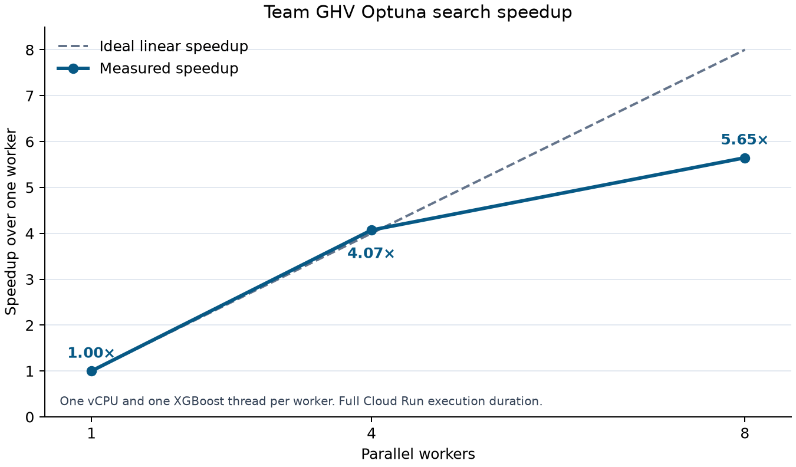

# Session 5 report — team-ghv

| Mesure | Valeur |
| --- | --- |
| Step 0 — Dataset row counts from `MANIFEST.json` and the starting champion | Training sample 611,548, validation 311,624, test 301,545. `fraud-scorer-team-ghv` (ID `5426531886748925952`), version `1`, aliases `default` and `champion`. |
| Step 1 — Baseline run ID, training code, image, seed, and validation AP | `20261118T182426Z5fd480`, commit `8c2691192d9cb5604b54bb8e9e605fac78a077c0`, image `europe-west1-docker.pkg.dev/advanced-cloud-ai/cloud-ai/fraud-train:td5`, seed 42, validation AP 0.8512. |
| Step 1 — Full execution duration and metadata timings | 83.81 s from execution creation to completion. `load` 19.24 s, `fit` 26.25 s, `eval` 2.99 s. |
| Step 1 — Repeat with the same training recipe | `20261118T184439Z680a8a`, validation AP 0.8512. Total 83.61 s, `load` 17.76 s, `fit` 20.84 s, `eval` 2.12 s. The execution used 4 vCPUs and 8 GiB. |
| Step 1 — Repeat at the original resource allocation | `20261118T185447Zeba41a`, validation AP 0.8512. Total 83.17 s, `load` 18.12 s, `fit` 25.42 s, `eval` 2.76 s. The execution used 1 vCPU and 2 GiB. |
| Step 3 — Twelve-month run ID, fit duration and validation AP | `20261118T195729Z8f59f7`, 704.83 s, AP 0.8823. Vertex AI job `3576263033648840704` succeeded. |
| Step 3 — September test AP, AP gain, 95% confidence interval, and verdict | Candidate 0.8732, champion 0.8421. The gate reported a gain of +0.0309 with a 95% confidence interval of [+0.0268, +0.0359]. Accepted because the lower bound exceeded 0.003. |
| Step 3 — Registry version and `rang_lecture_test` | Version `2` is `challenger` and `default`. Version `1` retains `champion`. Test-read rank `1`. |
| Step 4 — DDP throughput and validation AP with one and two processes | Pending. The instructor demonstration values were not recorded in the available notes. |
| Training job configuration | [`infra/job.tf`](../../infra/job.tf) |

## Baseline training (step 1)

Cloud Run execution `team-ghv-train-tz5c8` completed on 18 November 2026 with one successful task out of one. Cloud Run created the execution at 18:23:06.191 UTC and completed it at 18:24:30.002 UTC. The CLI separately reported 17.29 s to start the deployed execution. [Cloud Run execution details](https://console.cloud.google.com/run/jobs/executions/details/europe-west1/team-ghv-train-tz5c8?project=advanced-cloud-ai)

The job used one task, one requested vCPU, 2 GiB of memory and one XGBoost thread. XGBoost used 300 trees, maximum depth 6, learning rate 0.1, row and column subsampling of 0.8 each, and the `binary:logistic` objective. The runtime recorded Python 3.13.18, XGBoost 3.4.1 and NumPy 2.5.4. Validation ROC AUC was 0.9878.

The run used 20 features. Its metadata lists the training and validation files below. The September test count came from the manifest, and the test remains reserved for the gate.

| File | Role | Rows | SHA-256 |
| --- | --- | --- | --- |
| `train-sample.parquet` | Fit the model on the June–July 2026 sample | 611,548 | `3c5f3d728898237446a9146491c92b97c0a1954a41d96b195633d8683f2ef08e` |
| `valid.parquet` | Measure AP on August 2026 transactions | 311,624 | `3693335b5a27a1023b3c96fb38dc8706c83fe64efe6b92ceb8680457c5b7138d` |

The fingerprints, code commit, configuration, library versions and seed document the training recipe. Bit-for-bit reproduction also depends on the exact container image digest and the execution environment.

The repeat used Cloud Run execution `team-ghv-train-wpd8k`, with one successful task and one XGBoost thread. It produced a new run ID, `20261118T184439Z680a8a`. The two runs used the same input fingerprints, commit, seed, hyperparameters, library versions and container digest (`sha256:b0bbeb064fd6ae6fa574cc2bf241026362b10780958c5330b35cbb91d3f99469`). Both reported AP 0.8512 and ROC AUC 0.9878. Their `model.ubj` objects had the same size (1,069,718 bytes), MD5 (`vWUWcQybIvN8XU/6ApLeAQ==`) and CRC32C (`7cftCw==`), giving direct evidence that they produced the same model artifact. [Repeat execution details](https://console.cloud.google.com/run/jobs/executions/details/europe-west1/team-ghv-train-wpd8k?project=advanced-cloud-ai)

The first repeat inherited the job's 4 vCPUs and 8 GiB. Execution `team-ghv-train-wjfk8` repeated the original allocation of one task, 1 vCPU, 2 GiB and one XGBoost thread. Cloud Run created it at 18:53:27.737 UTC and completed it at 18:54:50.912 UTC. The CLI reported 21.63 s to start the deployed execution. The run ID changed to `20261118T185447Zeba41a`, while the reported validation metrics and model object size and checksums matched the first baseline. The full duration was 83.17 s versus 83.81 s for the original. [Repeat at the original allocation](https://console.cloud.google.com/run/jobs/executions/details/europe-west1/team-ghv-train-wjfk8?project=advanced-cloud-ai)

## Recherche (étape 2)

| Étude | Workers | vCPU par tâche | Threads | Essais terminés | `wall_seconds` | Durée de l'exécution | `sum_fit_seconds` | Meilleure AP | Tâches réussies / lancées |
| --- | --- | --- | --- | --- | --- | --- | --- | --- | --- |
| w1-t1 | 1 | 1 | 1 | 40 | 1535.77 s | 1590.60 s | 1372.77 s | 0.856104 | 1 / 1 |
| w4-t1 | 4 | 1 | 1 | 43 | 339.95 s | 390.73 s | 1170.63 s | 0.855967 | 4 / 4 |
| w8-t1-r2 | 8 | 1 | 1 | 47 | 231.54 s | 281.66 s | 1490.10 s | 0.854193 | 8 / 8 |
| w4-t4 | 4 | 4 | 4 | 43 | 155.03 s | 209.95 s | 538.52 s | 0.856489 | 4 / 4 |

Full duration is measured from Cloud Run execution creation to completion. The one-worker study ran as `team-ghv-train-9t79r`, the four-worker study as `team-ghv-train-jjckm`, and the clean eight-worker study as `team-ghv-train-clspm`. [One-worker execution details](https://console.cloud.google.com/run/jobs/executions/details/europe-west1/team-ghv-train-9t79r?project=advanced-cloud-ai), [four-worker execution details](https://console.cloud.google.com/run/jobs/executions/details/europe-west1/team-ghv-train-jjckm?project=advanced-cloud-ai), [clean eight-worker execution details](https://console.cloud.google.com/run/jobs/executions/details/europe-west1/team-ghv-train-clspm?project=advanced-cloud-ai)

`w4-t4` ran as `team-ghv-train-gdkvw`, with 8 GiB per task and four threads. Compared with `w4-t1`, the full duration fell from 390.73 s to 209.95 s. The trials in the two studies can use different hyperparameters, and CPU, memory and thread count changed together. [Four-worker, four-thread execution details](https://console.cloud.google.com/run/jobs/executions/details/europe-west1/team-ghv-train-gdkvw?project=advanced-cloud-ai)

Two overlapping executions used `w8-t1`. The shared summary reports 55 completed trials, a 139.59 s trial window, 1568.08 s of combined fit time, and best validation AP of 0.854193. Execution `team-ghv-train-xkk22` completed 8 of 8 tasks in 189.45 s. Execution `team-ghv-train-f6x26` completed 7 of 8 tasks in 148.63 s. Cloud Logging shows that its failed task hit `Stale file handle` while writing the shared `summary.json`. The clean study `w8-t1-r2` supplies the eight-worker measurement in the table and chart. [First eight-task execution](https://console.cloud.google.com/run/jobs/executions/details/europe-west1/team-ghv-train-xkk22?project=advanced-cloud-ai), [second eight-task execution](https://console.cloud.google.com/run/jobs/executions/details/europe-west1/team-ghv-train-f6x26?project=advanced-cloud-ai)

### Speedup

Speedup is the one-worker full execution duration divided by each full execution duration. The four-worker run finished 4.07× faster and had shorter fits on average (27.22 s per completed trial versus 34.32 s at one worker). The eight-worker run reached 5.65× with 31.70 s of fitting per completed trial. All four configurations had about 50–55 s between the full duration and the trial window. This gap includes work such as startup, loading data and writing results.

The four-worker tasks completed 11, 12, 10 and 10 trials. The eight-worker tasks completed 6, 6, 6, 5, 6, 5, 6 and 7. Workers finish trials already in progress when the study reaches 40, which can add up to 3 or 7 trials for the four- and eight-worker configurations. The eight-worker study did 1,490.10 s of total fitting compared with 1,372.77 s at one worker. Different trial parameters and durations, extra trials, and time outside the trial window help explain the observed curve.

With four workers and four threads per task, mean fit time fell from 27.22 s to 12.52 s per completed trial and full duration fell from 390.73 s to 209.95 s. The change also increased the CPU and memory allocations. Keep XGBoost threads within the vCPU allocation per task to limit competition for CPU. The studies explored different parameter sequences, so the best AP values alone do not establish an effect from parallelism. To test that effect, reuse a fixed set of parameter combinations and seeds across configurations and repeat the measurements.

### Cloud Run compute cost

Google Cloud's on-demand Tier 1 prices for `europe-west1`, checked 18 November 2026, were USD 0.000018 per vCPU-second and USD 0.000002 per GiB-second. For each successful task I used its Cloud Run start-to-completion duration, rounded up to 0.1 s with a 60 s minimum. I multiplied those seconds by `(vCPUs × CPU rate) + (GiB × memory rate)` and summed over tasks. Task timestamps approximate instance lifetimes. These estimates cover the four benchmark executions and exclude PostgreSQL, Cloud Storage, networking, free-tier credits, discounts and taxes. [Cloud Run pricing](https://cloud.google.com/run/pricing)

| Study | Estimated task seconds | Estimated compute cost (USD) | Estimated USD per completed trial |
| --- | ---: | ---: | ---: |
| `w1-t1` | 1563.6 | 0.03440 | 0.000860 |
| `w4-t1` | 1396.4 | 0.03072 | 0.000714 |
| `w8-t1-r2` | 1899.2 | 0.04178 | 0.000889 |
| `w4-t4` | 712.5 | 0.06270 | 0.001458 |
| Total | | 0.16960 | |

Four one-thread workers had the lowest estimated cost. Four four-thread workers had the shortest execution and about twice the estimated compute cost of four one-thread workers. For a model that takes ten times longer to fit, measure single-trial latency at different thread counts before increasing CPU across all workers. A single slow trial can keep the entire study open while other workers finish.

## Entraînement final sur Vertex AI (étape 3, 12 mois)

| Threads | `rows.train` | `load` | `fit` | AP de validation |
| --- | --- | --- | --- | --- |
| 8 | 36,629,935 | 939.19 s | 704.83 s | 0.8823 |

Vertex AI custom job `3576263033648840704` succeeded on 18 November 2026. It started at 19:30:02 UTC and ended at 19:57:40 UTC. The job spent 30 min 15.48 s between creation and start, then ran for 27 min 38 s on one `n2-standard-8` VM (8 vCPUs) with eight XGBoost threads. The run produced `model.ubj`, `features.json` and `metadata.json` under `runs/team-ghv/models/20261118T195729Z8f59f7/`.

The run read every monthly training shard from August 2025 through July 2026. The 12 row counts in its metadata add up to the same 36,629,935 rows as the manifest. Validation used 311,624 August 2026 rows, took 1.02 s, and produced AP 0.8823 and ROC AUC 0.9908. The run used the same code commit and seed as the baseline and the settings from `w8-t1/best.json`, which agree with the clean eight-worker study's best settings within floating-point rounding.

Compared with the original baseline, the final run fit about 59.90× as many rows and increased validation AP by 0.0311 (3.11 percentage points). The loading time rose from 19.24 s to 939.19 s, while fitting rose from 26.25 s to 704.83 s. Loading took longer than fitting in the 12-month run. Dataset size, hyperparameters, machine and thread count changed together, so the times cannot isolate the effect of eight threads.

The highest validation AP among the small-sample search studies was 0.856489 from `w4-t4`. The completed 12-month candidate used the eight-worker study settings. Three shorter jobs starting in May 2026 also succeeded (IDs `3540797186583298048`, `6484462493023338496` and `1500666555384463360`). The updated handout calls for one custom job per team. The 12-month run is the one used for the exercise and the gate.

### September test and registry decision

Cloud Run execution `team-ghv-train-dp68l` evaluated candidate `20261118T195729Z8f59f7` and the champion on the same 301,545 September 2026 test transactions. It completed one task in 237.14 s from execution creation to completion. The decision recorded `rang_lecture_test = 1` and `dry_run = false`. [Gate execution details](https://console.cloud.google.com/run/jobs/executions/details/europe-west1/team-ghv-train-dp68l?project=advanced-cloud-ai)

| Measure | Value |
| --- | --- |
| Candidate test AP | 0.8732, 95% CI [0.8631, 0.8813] |
| Champion test AP | 0.8421, 95% CI [0.8318, 0.8508] |
| AP gain reported by the gate | +0.0309, paired 95% CI [+0.0268, +0.0359] from 200 resamples |
| Acceptance rule and verdict | Accepted. The lower bound of +0.0268 exceeds the required margin of +0.003. |

Subtracting the displayed AP values gives +0.0311. The table preserves the gain and confidence interval reported by the gate, which used the interval's lower bound for its decision. The pre-set margin requires evidence of a gain of more than 0.3 percentage points and rejects tiny positive changes that can arise from training variability. We used August validation to choose hyperparameters and held September aside to evaluate the selected model on new transactions.

The decision file is `gs://advanced-cloud-ai-models/runs/team-ghv/decisions/20261118T214821473703Z-20261118T195729Z8f59f7.json`. The matching `.registre.json` receipt confirms registration as version `2` of `fraud-scorer-team-ghv` (model ID `5426531886748925952`). A separate Vertex AI registry check returned `default` and `challenger` on version `2` and `champion` on version `1`.

## Six questions

1. Quelles données, quel code et quelle configuration ont produit notre modèle ?
2. Combien de temps prend la recherche avec un, quatre et huit workers ?
3. Pourquoi le gain n'est-il pas proportionnel au nombre de workers ?
4. Combien a coûté notre recherche, et avec quelles hypothèses ?
5. Le modèle entre-t-il au registre, et sur quelle base ?
6. Démonstration DDP : qu'apporte le second processus, et pourquoi ? Une réponse par étudiant, signée
   de son prénom.

### Réponse à la question 6 — DDP

En DDP, chaque processus garde une copie complète du modèle (poids, gradients et état de l'optimiseur) et traite une part différente de chaque lot grâce au `DistributedSampler`. Après la rétropropagation, les gradients sont moyennés entre les processus par un *all-reduce*, puis chaque processus applique la même mise à jour, si bien que les copies restent identiques. Le second processus apporte donc surtout du débit : deux fois plus d'exemples traités par pas, pour une AP de validation équivalente. Le débit ne double pas pour autant : à chaque pas, les processus doivent échanger et moyenner leurs gradients et attendre le plus lent, ils se partagent les mêmes cœurs et la même bande passante mémoire sur CPU, et une partie du travail (démarrage, chargement des données, évaluation) n'est pas parallélisée ; sur un petit réseau, le temps de communication pèse lourd face au calcul. FSDP ou ZeRO s'imposent quand les poids, les gradients et l'état de l'optimiseur ne tiennent plus dans la mémoire d'un seul appareil : ils répartissent ces états entre les processus au lieu de les copier, au prix de plus de communications. Les débits et l'AP de la démonstration n'ont pas été relevés pendant la séance. — Marouane
