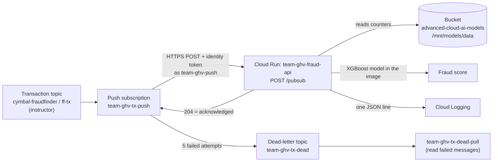

# Sessions 2 and 3 — summary, architecture and test guide (Team GHV)

Date: 12 November 2026. Status: Session 2 complete; Session 3 deployed and verified, load test, report and cleanup still pending.
No invoker identities, tokens or workstation paths are included.

## 1. What the system does

A transaction published to a Pub/Sub topic automatically triggers the scoring API. The API scores it with
the fraud model and logs the result.



### How a message flows

1. A transaction is published to the instructor's topic `ff-tx`. The team does not control that stream.
2. Pub/Sub pushes it through `team-ghv-tx-push` to `<service URL>/pubsub`, with a signed identity token
   for the service account `team-ghv-push`.
3. Cloud Run checks the token. The service is private: only the approved team members and
   `team-ghv-push` hold `roles/run.invoker`. Anonymous calls return **403**.
4. The `/pubsub` route decodes the base64 JSON in `message.data`, validates it as a `Transaction`, and
   scores it with `record=False`, so daily counters are never changed.
5. Scoring combines the transaction with the daily customer and terminal counters read from the bucket
   mounted at `/mnt/models/data`. The XGBoost model is built into the container image.
6. The route prints one JSON log line, for example
   `{"severity": "INFO", "message": "scored", "tx_id": ..., "score": ..., "message_id": ..., "delivery_attempt": ...}`.
7. It returns **204**, which acknowledges the message.
8. On failure: an invalid amount returns **422**, malformed input returns **400**. Any non-2xx response makes
   Pub/Sub retry with a 10 s to 60 s backoff. After **5 attempts** the message is forwarded to the
   dead-letter topic, readable through `team-ghv-tx-dead-pull`. Forwarding is best effort, so the attempt
   count is approximate.

### Why two identities

| Identity | Job | Needs |
| --- | --- | --- |
| `team-ghv-push` | Lets Pub/Sub call the private service | `run.invoker` on the service only |
| `cloudai-runner` (runtime) | Runs the container | Read access to the model bucket |

Neither carries the other's permissions.

### What the system does not do

- Pub/Sub triggers the API, not the other way round.
- The model is part of the API image; there is no separate model service.
- Scores are only logged. Publishing them to a team topic is the optional bonus and was not done.

## 2. Resources

| Resource | Managed by | Notes |
| --- | --- | --- |
| Cloud Run service `team-ghv-fraud-api` | Terraform (imported, `prevent_destroy`) | Port 8000, 1 vCPU, 0 to 3 instances, concurrency 1, private |
| Invoker binding `roles/run.invoker` | Terraform | Authoritative: team members plus `team-ghv-push` |
| Service account `team-ghv-push` | Terraform (`infra/pubsub.tf`) | Used only for Pub/Sub delivery |
| Topic `team-ghv-tx-dead` | Terraform | Dead-letter topic |
| Subscription `team-ghv-tx-dead-pull` | Terraform | Pull subscription to inspect failed messages |
| Subscription `team-ghv-tx-push` | Terraform | Topic `ff-tx`, OIDC push to `/pubsub`, 5 delivery attempts |
| Registry, model bucket, APIs, state bucket | Instructor | Read-only for the team |

Shared state: bucket `advanced-cloud-ai-tfstate`, prefix `team-ghv`.

## 3. What was done

### Session 2 — the service as code
- Built and pushed the `team-ghv-fraud-api` image and deployed a private Cloud Run service.
- Resolved the deployment problems:
  - the organization policy refused a service that disabled IAM invocation, so authentication stays required
  - the container must listen on **8000**, not 8080
  - the service failed at startup without the daily counter files, fixed by mounting the model bucket
    read-only and setting `DATA_DIR=/mnt/models/data`
- Brought the existing service under Terraform in the shared `team-ghv` state, protected from deletion.
- `terraform.tfvars` held the template values (`team1`), which planned a destroy-and-recreate of the live
  service. It now uses `team-ghv`. `prevent_destroy` blocked the plan, so nothing was touched.
- Measurements and results are in [report-session-2.md](report-session-2.md).

### Session 3 — automatic triggering
Infrastructure repository (branch `marouane_s3`):
- `infra/pubsub.tf`: the push account, push subscription with OIDC token, dead-letter topic and pull
  subscription. The endpoint is `<service URL>/pubsub`, the audience is the bare service URL, and the
  dead-letter policy allows 5 attempts.
- `infra/main.tf`: the push account was added to the authoritative invoker binding. No second binding was
  created for the same role.
- Pub/Sub's service agent already held token-creator, publisher and subscriber roles, so no extra grants
  were added.
- `scripts/terraform.py`: the guard now accepts the push account, the dead topic and the two subscriptions.
  The helper also finds `gcloud` on Windows through `shutil.which`.
- `infra/tests/policy.tftest.hcl`: the invoker assertion now expects the allowlist plus the push account.
  All 7 policy tests pass.

API repository (branch `marouane_s3`, pushed):
- `app.py`: new `POST /pubsub` route.
- `tests/test_api.py`: new tests for 204 plus log line, unchanged counters, non-positive amounts and
  malformed input. All 26 tests pass and Ruff is clean.

Deployment:
- The first image was built with port 8080 and was rejected. After restoring the Dockerfile to port 8000
  the image was rebuilt as `team-ghv-fraud-api:s3b`, digest
  `sha256:b905cb02851a0f07222a4331eb6276f74a5ae5f6d8884f517641080d701ec6aa`.
- A local smoke test with the sample envelope returned 204 and the `scored` log line.
- The reviewed saved plan was 0 to add, 1 to change, 0 to destroy (the image only), and was applied through
  the guarded helper. Revision `team-ghv-fraud-api-00005-xws` now serves it.

## 4. Verification results

| Check | Result |
| --- | --- |
| Live revision | `00005`, digest `sha256:b905cb02…` |
| Pub/Sub deliveries | `/pubsub` returns 204; logs show `scored` lines with `delivery_attempt` 1 |
| Anonymous `POST /pubsub` | 403 |
| Authorized message with a negative amount | 422 and an `ERROR` log line: `rejected`, reason `invalid` |
| Dead-letter queue | Holds messages from before the deployment, when `/pubsub` returned 404 |

Before the new revision, the subscription was already active and the route returned 404 for every push.
Those messages reached the dead-letter topic.

## 5. How to test it

```bash
# Live deliveries and their status codes
gcloud logging read 'resource.type="cloud_run_revision" AND resource.labels.service_name="team-ghv-fraud-api" AND httpRequest.requestUrl:"/pubsub"' \
  --project advanced-cloud-ai --freshness 10m --limit 10 --format 'value(timestamp,httpRequest.status)'

# One structured line per scored message
gcloud logging read 'resource.type="cloud_run_revision" AND resource.labels.service_name="team-ghv-fraud-api" AND jsonPayload.message="scored"' \
  --project advanced-cloud-ai --freshness 10m --limit 10 --format 'value(timestamp,jsonPayload.tx_id,jsonPayload.score,jsonPayload.delivery_attempt)'

# Rejected messages (search by severity; ingestion can lag by a minute)
gcloud logging read 'resource.type="cloud_run_revision" AND resource.labels.service_name="team-ghv-fraud-api" AND severity>=ERROR' \
  --project advanced-cloud-ai --freshness 20m --limit 10 --format 'value(timestamp,severity,jsonPayload.message,jsonPayload.reason)'

# Send the sample message by hand (expect 204; without the Authorization header, expect 403)
URL=$(gcloud run services describe team-ghv-fraud-api --project advanced-cloud-ai --region europe-west1 --format 'value(status.url)')
curl -i -X POST "$URL/pubsub" -H "Authorization: Bearer $(gcloud auth print-identity-token)" \
  -H "Content-Type: application/json" --data-binary @docs/seance-3/enveloppe.json

# Failed messages (does not acknowledge; add --auto-ack only after capturing evidence)
gcloud pubsub subscriptions pull team-ghv-tx-dead-pull --project advanced-cloud-ai --limit 5
```

In the console, Pub/Sub → Subscriptions → `team-ghv-tx-push` shows **Undelivered messages** and
**Oldest unacked message age**. Cloud Run → `team-ghv-fraud-api` → Metrics shows instance count and
p50/p99 latency.

## 6. Applying changes safely

Always use the guarded helper and a saved plan, from WSL or Git Bash:

```bash
python scripts/terraform.py plan -var-file=terraform.tfvars -out=session3.tfplan
# read it: no replacement or deletion of google_cloud_run_v2_service.api
python scripts/terraform.py apply session3.tfplan
```

A new image tag alone does not deploy anything. Pin the new digest in the git-ignored
`infra/terraform.tfvars`, then plan and apply. Never run `terraform destroy` on the shared state.

## 7. Remaining

- Commit and push the infrastructure repository changes on `marouane_s3`.
- Add guard tests for the new Pub/Sub rules in `tests/test_execution_guards.py`.
- Run `terraform fmt` in `infra/` (it still flags `main.tf` and `pubsub.tf`).
- Restore `docs/seance-3/pubsub.tf`, which was moved rather than copied, so the instructor's sync check
  still finds it.
- Coordinate the replay window with the instructor and switch `tx_topic` to
  `projects/advanced-cloud-ai/topics/ff-replay`. This replaces the push subscription and drops its backlog,
  so review that plan; it must never replace the Cloud Run service.
- At each load level, record backlog, oldest unacked age, peak instances and p50/p99.
- Trace the instructor's invalid `tx_id` through the logs to the dead-letter queue and record the delivery
  attempts actually observed.
- Fill `docs/seance-3/compte-rendu.md` with measured values only.
- At the end of the session, remove the push subscription through a reviewed, scoped Terraform change so it
  stops calling the service. Keep the main service and the shared foundation.
